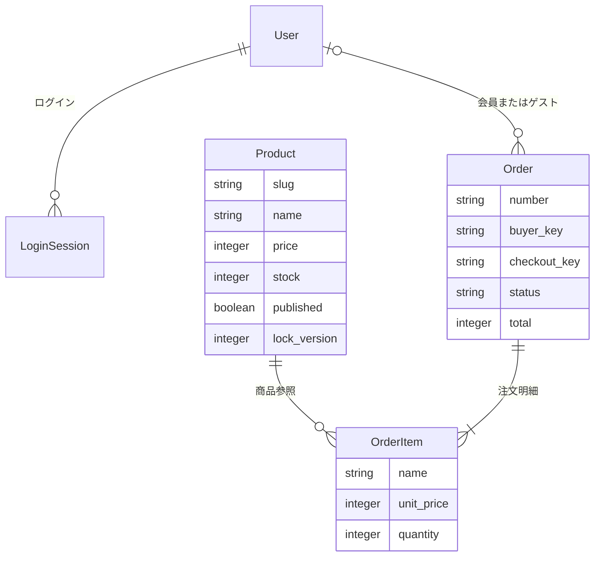

# 余白 / YOHAKU — Rails EC Store

暮らしの道具を扱う、ポートフォリオ・学習用のECストアです。商品を探す → 詳細を見る → カートに入れる → 配送先を入力する → デモ注文する、という流れをRuby on Railsで実装しています。

**実際の決済・配送・メール送信はありません。** 商品、ブランド、住所サンプルは架空で、掲載写真はAI生成です。外部サービスのアカウントやAPIキーは不要です。

公開リポジトリ: [Sparklingstadt/rails-ec-store](https://github.com/Sparklingstadt/rails-ec-store)。[v0.1.0](https://github.com/Sparklingstadt/rails-ec-store/releases/tag/v0.1.0) は最初のゲスト購入版を固定したリリースです。`main` には、その後の会員機能・管理画面・注文管理・検索拡張を順に追加しています。

## 起動する

Ruby **3.4.1** と Bundler を用意して、このフォルダで実行します。

```sh
bundle install
bin/rails db:prepare
bin/dev
```

[http://127.0.0.1:3100](http://127.0.0.1:3100) を開きます。終了は `Ctrl+C` です。

- 初回の `db:prepare` でテーブルとサンプル商品6件が作られます。
- まとめてセットアップする場合は `bin/setup` でも起動できます。
- ポートを変える場合は `PORT=3200 bin/dev` を実行します。
- Node.js、PostgreSQL、Redis、Dockerは実行に不要です。
- `bundle install` の初回だけはgemを取得するためインターネット接続が必要です。画像・CSS・JavaScriptはすべてローカルに含まれています。

## 体験できる機能

| 機能 | 内容 |
| --- | --- |
| 商品一覧 | 初期商品6件、カテゴリ4種、新着、キーワード・価格帯・在庫で検索、4通りの並び替え、12件ずつページ表示 |
| 商品詳細 | 写真、説明、素材・サイズ、在庫表示、数量選択 |
| お気に入り | 追加・解除、専用一覧。会員はDB、ゲストはCookieに保存 |
| カート | 追加、数量更新、削除、税込金額・送料の計算 |
| チェックアウト | 配送先の検証、サンプル情報入力、デモ注文 |
| 会員機能 | 登録・ログイン・ログアウト、マイページ、お届け先保存、カート・お気に入りの引き継ぎ |
| 注文完了・履歴 | 注文時の名前・価格を保存、本人の最近30件を表示。会員は別ブラウザでもログイン後に閲覧可能 |
| 商品管理 | 管理者による作成・編集、在庫・公開状態の変更、同時編集の競合検出 |
| 注文管理 | 受付済み・発送済み（デモ）・キャンセル済み。受付中は購入者もキャンセル可能、在庫戻しは一度だけ |
| レスポンシブ画面 | PCとスマートフォンに対応、キーボード操作・フォーカス表示 |

送料は550円、商品小計8,000円以上で無料です。商品単価は整数の円で扱い、表示価格は税込です。1商品につき最大20点まで注文できます。

## デモ注文を試す

1. 「日々のマグカップ」を開き、数量を2にしてカートへ追加します。
2. 小計4,800円・送料550円・合計5,350円になっていることを確認します。
3. 「ご注文手続きへ」→「サンプル情報を入力する」を押します。
4. 「デモ注文を確定する」を押すと、注文番号と明細が表示されます。
5. カートが空になり、DBの在庫が2減ります。フッターの「注文履歴」から注文を再確認できます。

実在の個人情報は入力せずサンプルを使ってください。ゲストのデータはCookieを失うとアクセスできなくなります。同じブラウザで会員登録・ログインすると、ゲストのカート・お気に入り・未紐付けの注文が会員へ引き継がれます。会員のデータはDBに保存され、再ログイン後に利用できます。ログインの有効期間は30日です。

受付中の注文詳細では「この注文をキャンセル」から在庫を戻せます。発送済み・キャンセル済みの注文は、元の状態へ戻せません。

## 技術構成

- Ruby 3.4.1 / Rails 8.1.3.1
- SQLite 3 / Active Record / Puma
- ERBによるサーバーレンダリング
- 素のCSS・JavaScript。主要機能はJavaScriptなしでも利用可能
- Minitest / RuboCop / Brakeman / bundler-audit
- GitHub Actionsでテスト・静的解析・脆弱性確認を実行

`Gemfile.lock` を共有することで、同じ依存関係を再現できます。Rails 8.1のJSONデコーダーとJSON 3の引数仕様が異なるため、JSON gemは互換性を確認した2系に制約しています。

## コードを読む順番

1. [`config/routes.rb`](config/routes.rb) — URLとControllerの対応
2. [`app/controllers/products_controller.rb`](app/controllers/products_controller.rb) — 検索・絞り込みと表示
3. [`app/models/product.rb`](app/models/product.rb) — 商品の検証、検索scope、並び替えの許可リスト
4. [`app/models/cart.rb`](app/models/cart.rb) — カートの数量・送料計算。DBテーブルを持たないRubyクラス
5. [`app/controllers/concerns/authentication.rb`](app/controllers/concerns/authentication.rb) — ログインセッションとゲストデータの引き継ぎ
6. [`app/services/place_order.rb`](app/services/place_order.rb) — 注文・在庫更新のトランザクション
7. [`test/integration/store_flow_test.rb`](test/integration/store_flow_test.rb) — 一連の購入フローの検証
8. [`app/services/change_order_status.rb`](app/services/change_order_status.rb) — 注文状態遷移と在庫戻し
9. [`app/models/product_search.rb`](app/models/product_search.rb) — 条件の検証、絞り込み、ページ切り替え

詳細は **[学習ガイド](docs/LEARNING.md)** を参照してください。**[検証記録](docs/VERIFICATION.md)** と **[画像・生成プロンプト](docs/ASSETS.md)** も同梱しています。

## データ構造



カートには商品IDと数量だけを保存します。会員のカート・お気に入りはUserのJSON列、ゲストは暗号化Cookieセッションに保持します。注文時の商品名・価格を明細へコピーするため、商品情報を変更しても過去の購入内容は変わりません。

## 品質確認

```sh
bin/rails test
bin/rails zeitwerk:check
RUBOCOP_CACHE_ROOT=tmp/rubocop bin/rubocop
bin/brakeman --quiet --no-pager
BUNDLER_AUDIT_DB=tmp/ruby-advisory-db bin/bundler-audit check --update
```

テストは `storage/test.sqlite3` を使い、開発用の注文や在庫は変更しません。脆弱性DBを更新する最後のコマンドはネットワーク接続が必要です。

## 管理画面を使う

1. 右上のログインアイコンから新規会員登録します。パスワードは12文字以上、BCryptの上限は72バイトです。
2. 登録したメールアドレスを指定して、その会員に管理者権限を付与します。

```sh
bin/rails admin:grant EMAIL=your-sample@example.com
```

3. マイページの「ストア管理」を開きます。商品管理は `/admin/products`、注文管理は `/admin/orders` です。

初期管理者・共通パスワードは用意していません。管理者権限は画面のパラメータから変更できません。商品画像は同梱の6種類から選びます。商品の削除はせず、非公開にして注文記録を保ちます。編集後に注文が入るなど競合が起きた場合は保存を拒否し、最新値を表示します。

管理者は最新100件の注文を状態別に確認し、受付済みの注文を発送済み（デモ）またはキャンセル済みへ変更できます。実配送にはつながりません。`db:seed` は既存商品の在庫や注文を上書きしません。

開発用データを**すべて消して**初期状態に戻す場合に限り、サーバーを止めて `bin/rails db:reset` を実行してください。

## 実装の範囲

このアプリはローカルで学習・作品紹介を行うためのデモです。実決済、配送連携、メール送信・メール認証、パスワード再設定、画像アップロードは未実装です。GitHubでソースを公開しており、外部ホスティングにはデプロイしていません。

登録・ログインにはIP単位の試行回数制限がありますが、保存先はプロセス内メモリです。複数プロセス運用には共有キャッシュが必要です。ゲストCookieのサイズ、会員JSONデータの同時更新、失効済みログインセッションの定期削除も運用時の検討事項です。本番公開には、上記の未実装機能に加えてバックアップ・個人情報の保管方針・永続DBを設計し、`config/database.yml` のproduction接続先を設定してください。

公開する場合も `config/master.key`、`.env`、`storage/`、`log/` はGitへ追加しないでください。`.gitignore` に設定済みです。
