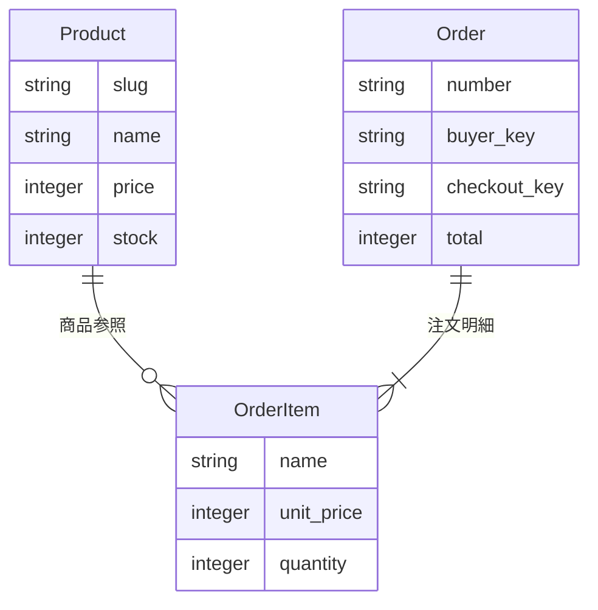

# 余白 / YOHAKU — Rails EC Store

暮らしの道具を扱う、ポートフォリオ・学習用のECストアです。商品を探す → 詳細を見る → カートに入れる → 配送先を入力する → デモ注文する、という流れをRuby on Railsで実装しています。

**実際の決済・配送・メール送信はありません。** 商品、ブランド、住所サンプルは架空で、掲載写真はAI生成です。外部サービスのアカウントやAPIキーは不要です。

## 起動する

Ruby **3.4.1** と Bundler を用意して、このフォルダで実行します。

```sh
bundle install
bin/rails db:prepare
bin/dev
```

[http://127.0.0.1:3100](http://127.0.0.1:3100) を開きます。終了は `Ctrl+C` です。

- 初回の `db:prepare` でテーブルとサンプル商品6件が作られます。
- まとめてセットアップする場合は `bin/setup` でも起動できます。
- ポートを変える場合は `PORT=3200 bin/dev` を実行します。
- Node.js、PostgreSQL、Redis、Dockerは実行に不要です。
- `bundle install` の初回だけはgemを取得するためインターネット接続が必要です。画像・CSS・JavaScriptはすべてローカルに含まれています。

## 体験できる機能

| 機能 | 内容 |
| --- | --- |
| 商品一覧 | 商品6件、カテゴリ4種、新着商品、キーワード検索、4通りの並び替え |
| 商品詳細 | 写真、説明、素材・サイズ、在庫表示、数量選択 |
| お気に入り | 追加・解除、専用一覧。ブラウザのCookieに保存 |
| カート | 追加、数量更新、削除、税込金額・送料の計算 |
| チェックアウト | 配送先の検証、サンプル情報入力、デモ注文 |
| 注文完了・履歴 | 注文時の名前・価格を保存、同じブラウザの最近30件を表示 |
| レスポンシブ画面 | PCとスマートフォンに対応、キーボード操作・フォーカス表示 |

送料は550円、商品小計8,000円以上で無料です。商品単価は整数の円で扱い、表示価格は税込です。1商品につき最大20点まで注文できます。

## デモ注文を試す

1. 「日々のマグカップ」を開き、数量を2にしてカートへ追加します。
2. 小計4,800円・送料550円・合計5,350円になっていることを確認します。
3. 「ご注文手続きへ」→「サンプル情報を入力する」を押します。
4. 「デモ注文を確定する」を押すと、注文番号と明細が表示されます。
5. カートが空になり、DBの在庫が2減ります。フッターの「注文履歴」から注文を再確認できます。

実在の個人情報は入力しないでください。Cookieを削除したり別ブラウザを使ったりすると、以前のカート・お気に入り・注文履歴にはアクセスできません。Cookieの有効期間は30日です。

## 技術構成

- Ruby 3.4.1 / Rails 8.1.3.1
- SQLite 3 / Active Record / Puma
- ERBによるサーバーレンダリング
- 素のCSS・JavaScript。主要機能はJavaScriptなしでも利用可能
- Minitest / RuboCop / Brakeman / bundler-audit
- GitHub Actions向けCI設定を同梱（GitHubへの公開・実行は未実施）

`Gemfile.lock` を共有することで、同じ依存関係を再現できます。Rails 8.1のJSONデコーダーとJSON 3の引数仕様が異なるため、JSON gemは互換性を確認した2系に制約しています。

## コードを読む順番

1. [`config/routes.rb`](config/routes.rb) — URLとControllerの対応
2. [`app/controllers/products_controller.rb`](app/controllers/products_controller.rb) — 検索・絞り込みと表示
3. [`app/models/product.rb`](app/models/product.rb) — 商品の検証、検索scope、並び替えの許可リスト
4. [`app/models/cart.rb`](app/models/cart.rb) — カートの数量・送料計算。DBテーブルを持たないRubyクラス
5. [`app/controllers/cart_items_controller.rb`](app/controllers/cart_items_controller.rb) — Cookieセッションの更新
6. [`app/services/place_order.rb`](app/services/place_order.rb) — 注文・在庫更新のトランザクション
7. [`test/integration/store_flow_test.rb`](test/integration/store_flow_test.rb) — 一連の購入フローの検証

詳細は **[学習ガイド](docs/LEARNING.md)** を参照してください。**[検証記録](docs/VERIFICATION.md)** と **[画像・生成プロンプト](docs/ASSETS.md)** も同梱しています。

## データ構造



カートには商品IDと数量だけを保存します。注文時の商品名・価格を明細へコピーするため、商品情報を変更しても過去の購入内容は変わりません。

## 品質確認

```sh
bin/rails test
bin/rails zeitwerk:check
RUBOCOP_CACHE_ROOT=tmp/rubocop bin/rubocop
bin/brakeman --quiet --no-pager
BUNDLER_AUDIT_DB=tmp/ruby-advisory-db bin/bundler-audit check --update
```

テストは `storage/test.sqlite3` を使い、開発用の注文や在庫は変更しません。脆弱性DBを更新する最後のコマンドはネットワーク接続が必要です。

## 商品を変更する

学習用のため管理画面は設けていません。Railsコンソールから更新できます。

```sh
bin/rails console
```

```ruby
product = Product.find_by!(slug: "everyday-mug")
product.update!(price: 2600, stock: 24)
```

商品を追加する場合は `db/seeds.rb` にデータと `public/images/` に写真を追加し、`bin/rails db:seed` を実行します。seedは既存商品の在庫や注文を上書きしません。

開発用データを**すべて消して**初期状態に戻す場合に限り、サーバーを止めて `bin/rails db:reset` を実行してください。

## 実装の範囲

このアプリはローカルで学習・作品紹介を行うためのデモです。ゲスト購入を採用しており、会員認証、管理画面、実決済、配送連携、メール送信は未実装です。

本番運用へ発展させる場合は、認証と管理者権限、決済サービスとWebhook、注文ステータス、レート制限、配送・個人情報の保管方針、データベースのバックアップを別途設計してください。SQLiteのデータファイルを永続化できるRails実行環境が必要です。

公開する場合も `config/master.key`、`.env`、`storage/`、`log/` はGitへ追加しないでください。`.gitignore` に設定済みです。
